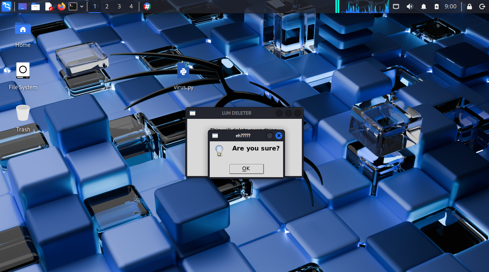
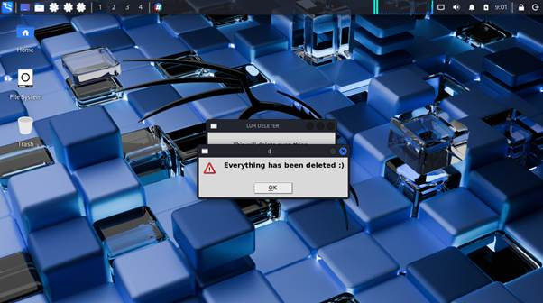

# Linux Deletion Virus — Sandboxed Experiment

>  EDUCATIONAL PROJECT — DO NOT RUN OUTSIDE A CONTROLLED VM**
> This script was created and executed **only inside a virtual machine** as part of an academic cybersecurity experiment. It demonstrates how destructive commands behave on Linux and why OS-level protections matter.

## Project Overview

This experiment explored two questions:

1. Can a Python GUI application disguise a destructive command as a harmless program?
2. Does Linux protect its core filesystem from `rm -rf ~/` when run as a standard user?

The program was built in Python with Tkinter, executed on a Linux VM, and documented through screenshots and analysis.

## What the Program Does

- Opens a Tkinter GUI titled "LUH DELETER"
- Displays a warning label and an "OK" button
- On click: shows a confirmation dialog, executes `rm -rf ~/`, then shows a final warning

**It is not a real virus. It is a proof-of-concept built for a coursework milestone.**

Hypothesis: The command would wipe the entire system.

Outcome: ❌ Failed — Linux protected itself.

User files in ~/ were affected

System folders (/bin, /etc, /lib, /boot, etc.) remained intact

Linux's permission model prevented a standard user from damaging the OS

This demonstrated an important cybersecurity principle: modern OS-level permissions are a critical line of defense against destructive scripts.

Screenshots
Stage	Preview
Initial GUI	

Confirmation dialog	

After warning 

